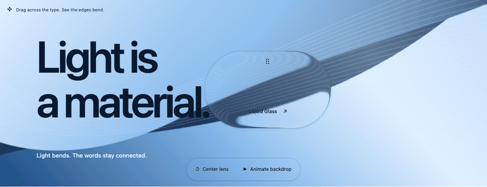

# @liquid-glass-forge/core

Data contracts and reference math for the Forge material engine.

[](https://namipsg.github.io/liquid-glass-forge/#playground)

[Live showcase](https://namipsg.github.io/liquid-glass-forge/#playground) · [Examples](https://namipsg.github.io/liquid-glass-forge/examples.html) · [Documentation](https://github.com/namipsg/liquid-glass-forge/blob/main/docs/CONTRACTS.md) · [Support](https://namipsg.github.io/liquid-glass-forge/support.html) · [Install by framework](https://github.com/namipsg/liquid-glass-forge/blob/main/docs/QUICKSTART.md)

## Install

```sh
npm install @liquid-glass-forge/core@0.1.0-rc.2
```

Keep the Forge packages at matching versions. This is an experimental preview.
The [support guide](https://namipsg.github.io/liquid-glass-forge/support.html) describes browser and device qualification.

## Usage

Experimental preview of the versioned core contracts. This package validates explicit RGBA8
source/frame descriptors and provides small color-reference functions. It does not
render glass, read DOM content, create workers, or provide framework adapters.

ESM and TypeScript declarations are built from `src/`. Importing the package is
safe without browser globals. The package has no runtime dependencies or install
hooks. Public API changes remain possible before an initial release.

See the repository's `docs/CONTRACTS.md` for units, ownership, optical model and
lifecycle requirements. Safari/WebKit cadence remains unqualified; its phase 1
progression prerequisite was explicitly waived by the project owner.

MIT licensed. See LICENSE and NOTICE for independent-project attribution.
